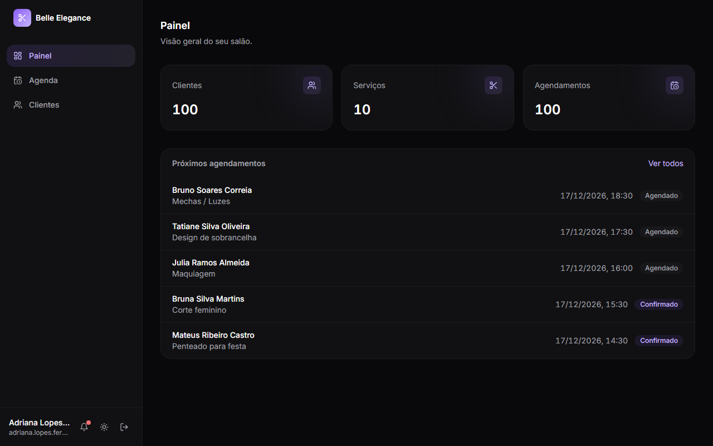
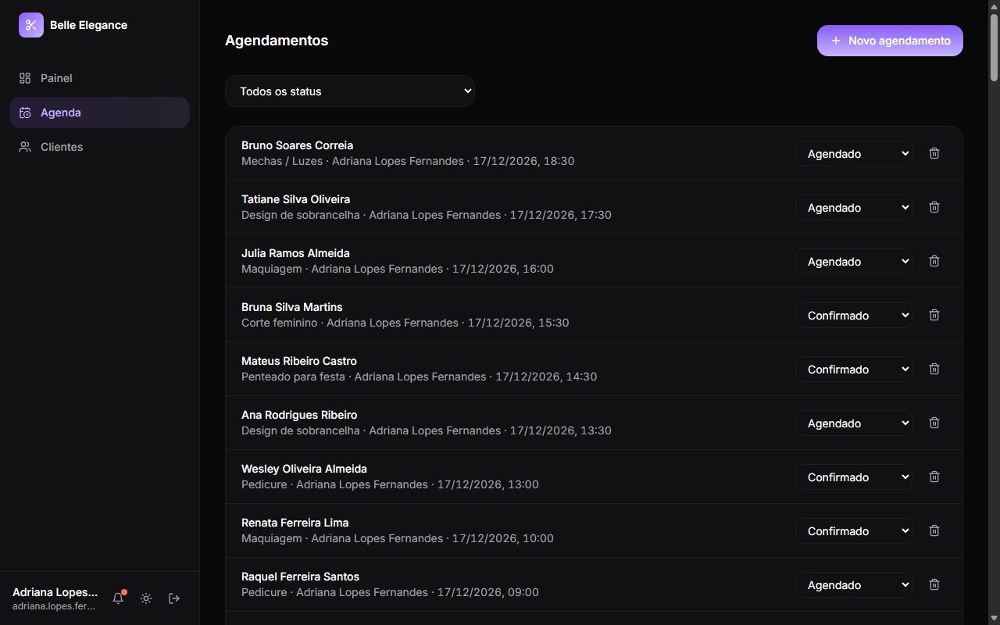
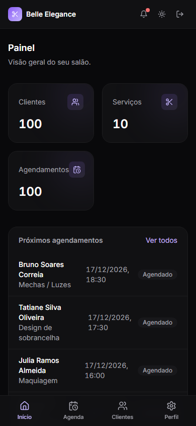

<div align="center">

# 💈 Plataforma Style

### Site, agendamento online e gestão para salões, barbearias e clínicas de estética, em uma única plataforma.

Cada salão assinante ganha **site público próprio**, **agendamento sem login** e um **painel administrativo**. Uma equipe da plataforma gerencia todos os salões pelo **Painel Mestre**.



[🌐 Ver online](https://salao.andre-aguiar-jr.com.br) · [📚 Documentação completa](DOCUMENTACAO/README-completo.md)

</div>

> Dados das capturas de tela **fictícios** (gerados por `npm run seed:demo`).

## O problema que resolve

Salões pequenos agendam por WhatsApp e caderno: horários se sobrepõem, clientes faltam sem aviso e o dono não sabe quanto faturou nem quanto sobrou. A Plataforma Style entrega o agendamento online, o cadastro de clientes, o financeiro e o estoque em um só lugar, **sem que cada salão precise montar a própria tecnologia**.

## O que ele faz

| | |
|---|---|
|  | **Site público do salão** (`/:salaoId`), com templates por segmento (feminino, barbearia, unissex, estética) e blocos de apresentação, equipe, serviços, avaliações e contato. |
|  | **Agenda e gestão.** Clientes, serviços, profissionais (com jornada e ausências), status dos agendamentos e papéis de acesso (dono, gerente, profissional, recepcionista). |

- **Agendamento online sem login:** o cliente busca o próprio cadastro pelo telefone, escolhe serviço, profissional e horário. Os horários livres consideram a jornada e as ausências de cada profissional (grade de 15 minutos).
- **Financeiro, estoque e relatórios:** pagamentos (dinheiro, Pix, cartão), despesas, comissão por profissional, faturamento e lucro; produtos com entrada/saída e alerta de estoque baixo ou vencido; clientes novos e clientes que sumiram.
- **Painel Mestre:** cadastro de salões, plano, status do contrato e suspensão.
- **Cadastro self-service** com teste grátis de 14 dias, redefinição de senha por e-mail e trilha de auditoria das ações sensíveis.
- **Notificações por WhatsApp** (Cloud API oficial da Meta): confirmação, lembrete e cancelamento. Opcional e desligado por padrão.
- **App Android** (Capacitor) que aponta para o site publicado.

<p>
  
  
</p>

## Tecnologias

| Camada | Tecnologia |
|---|---|
| Front-end | React 18, Vite 5, Tailwind CSS 3, React Router, Capacitor (Android) |
| API | Node.js 20, Express, Prisma 5, JWT em cookie `httpOnly`, bcryptjs, helmet, rate limit |
| Banco | PostgreSQL 16 |
| Testes e qualidade | `node:test` (45 testes), ESLint |
| Execução | Docker (`deploy/docker-compose.yml`) |

## Executar localmente

Requisitos: **Node.js 20+**, **PostgreSQL 16**. Testado no Windows com Node 22 e PostgreSQL 16.

```bash
git clone https://github.com/anndrehjr/gerenciador-loja.git
cd gerenciador-loja

# 1) Banco: crie um banco vazio (exemplo: createdb gerenciador_loja)

# 2) API
cd backend
cp .env.example .env              # preencha DATABASE_URL e JWT_SECRET (um valor longo e aleatório)
npm ci
npx prisma migrate deploy         # cria as tabelas
SEED_ADMIN_SENHA='uma-senha-forte' npm run seed     # salão e administrador de exemplo (admin@salao.local)
npm run dev                       # http://localhost:4000

# 3) Front-end (outro terminal)
cd frontend
npm ci
npm run dev                       # http://localhost:5173 (o Vite repassa /api para :4000)
```

No PowerShell, troque `VAR=valor comando` por `$env:VAR='valor'; comando`.

- **Dados de demonstração:** `npm run seed:demo` (dentro de `backend/`) gera 20 empresas fictícias completas, com 24 meses de histórico. Todo usuário gerado usa a senha `Demo@12345` e o e-mail de cada um aparece no log da execução. Detalhes em [`DOCUMENTACAO/SeedDemonstrativo.md`](DOCUMENTACAO/SeedDemonstrativo.md).
- **Painel Mestre:** crie a conta com `SEED_MESTRE_EMAIL=... SEED_MESTRE_SENHA=... SEED_ADMIN_SENHA=... npm run seed` e entre em `http://localhost:5173/login`.
- **Cookie em HTTP:** no `.env` local use `COOKIE_SECURE=false` (em produção, `true` com HTTPS).

### Testes e verificações

```bash
cd backend  && npm test           # 45 testes (inclui testes de integração; usam o DATABASE_URL do .env)
cd frontend && npm run lint && npm run build
```

Os testes de integração criam salões de teste no banco configurado: use um banco de desenvolvimento.

## Estrutura

```
backend/    API Express + Prisma (src/, prisma/ com migrações e seeds)
frontend/   Aplicação React (site público, painel do salão, Painel Mestre) e projeto Android (Capacitor)
deploy/     docker-compose de produção
DOCUMENTACAO/   Arquitetura, banco, instalação, permissões, manual do usuário e README completo
```

## Segurança

Senhas com bcrypt, sessão JWT em cookie `httpOnly`, helmet, rate limit (inclusive nas rotas públicas), CORS restrito, papéis com permissões por recurso, isolamento de dados por salão e log de auditoria. Mais detalhes em [`DOCUMENTACAO/README-completo.md`](DOCUMENTACAO/README-completo.md#-segurança).
